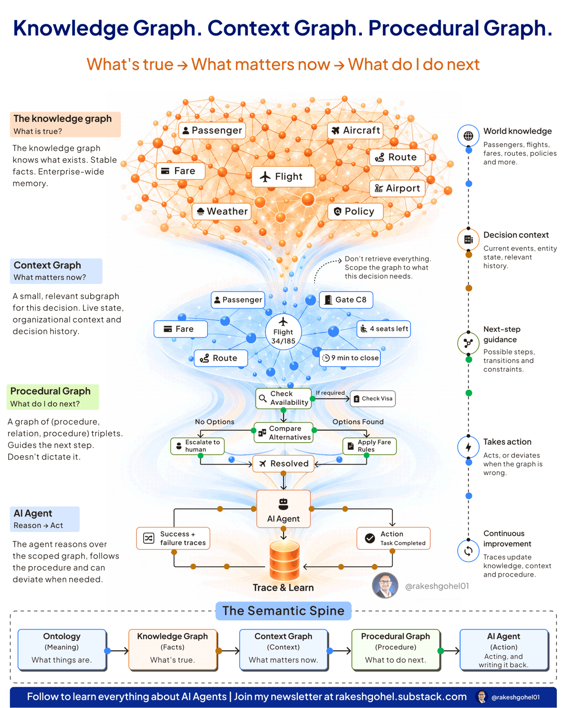

# Knowledge and Context and Procedural Graphs 
- Every decision your AI agent makes depends on three questions: what is true, what matters right now, and what should happen next.
- A knowledge graph answers the first one very well, and each of the other two deserves its own graph. Take a simple request: “Rebook this passenger.”
    - Knowledge graph: what is true
- Passengers, flights, fares, routes and policies, kept stable and governed across the enterprise.
    - Context graph: what matters now
- A small slice of that knowledge scoped to this decision, such as Gate C8, four seats left and nine minutes to close, plus how similar cases went before.
    - Procedural graph: what to do next
- Procedures stored as (procedure, relation, procedure) triplets, so the agent moves from Check Availability to Compare Alternatives to Resolved, checks the visa when required, and escalates to a human when no options exist.
- The agent reasons over that scoped context, follows the next edge, and is free to deviate when the graph is wrong. Every trace is written back, so precedents sharpen context, failed runs fix the procedure, and repeated patterns become governed facts.

- My takeaway: scope the graph per step, store the procedure as a graph instead of a prompt, and log every decision, because that log becomes your audit trail.
---
